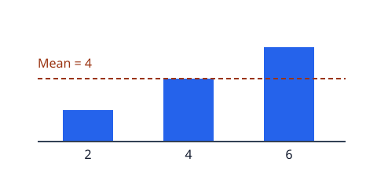

<!-- reader-part
{
  "version": 1,
  "id": "C01-P01",
  "source_sha256": "9c8c3226737e41f371f1a996c02c3056d123511f42c4dd6737d5fc30641bab0a",
  "pdf_pages": [
    3,
    3
  ],
  "questions": [
    {
      "id": "C01-P01-Q01",
      "part_id": "C01-P01",
      "question": "How do you calculate the arithmetic mean?"
    },
    {
      "id": "C01-P01-Q02",
      "part_id": "C01-P01",
      "question": "Why must the values use the same unit?"
    }
  ]
}
-->

# C01-P01 · Understanding the mean

The arithmetic mean shares a total equally across its observations. Add the values, then divide by how many values there are.

## A small example

For the values 2, 4, and 6, the total is 12 and there are three observations. Their mean is 4.

| Value | Contribution to the total |
| --- | --- |
| 2 | 2 |
| 4 | 4 |
| 6 | 6 |



The dashed line shows the equal share. Individual observations can lie above or below it.

## Calculate the mean

```python
values = [2, 4, 6]
mean = sum(values) / len(values)
print(mean)  # 4.0
```

For $n$ values $x_1, \ldots, x_n$, the same calculation is

$$
\bar{x} = \frac{1}{n} \sum_{i=1}^{n} x_i.
$$

There must be at least one value. All values must describe the same quantity in the same unit; the mean keeps that unit.

## Check your understanding

### C01-P01-Q01

How do you calculate the arithmetic mean?

### C01-P01-Q02

Why must the values use the same unit?

---

Source: PDF pages 3-3; printed pages 1.
